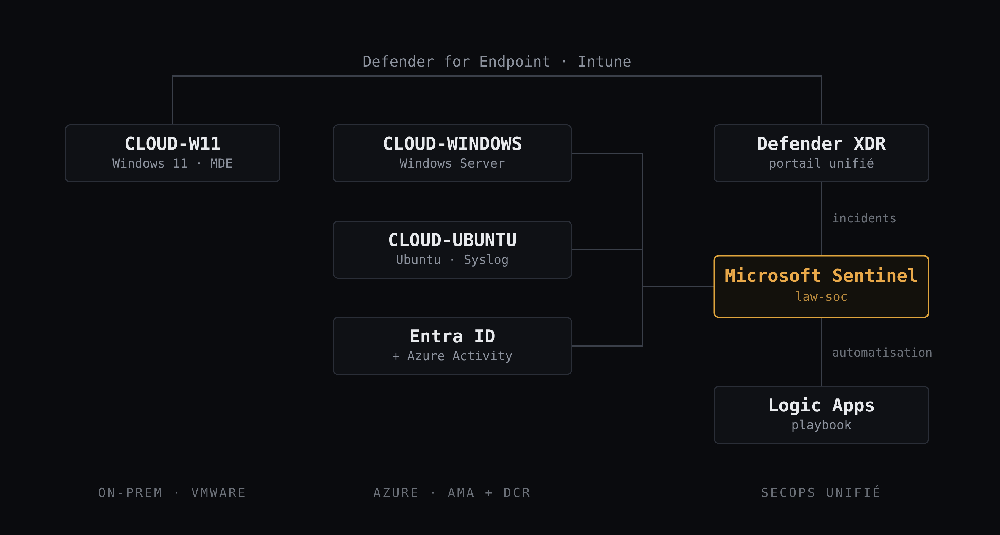

# 🛡️ SOC Lab · Microsoft Sentinel & Defender XDR

Laboratoire SecOps Microsoft monté from scratch dans un seul tenant = expérience pratique sur l'ensemble des compétences d'analyste des opérations de sécurité.

> Chaque phase est documentée de bout en bout, y compris ce qui a échoué et comment je l'ai corrigé :
> ```
> ingestion → détection → automatisation → investigation → hunting
> ```

---

## 🎯 Objectif

Pratiquer chaque compétence d'analyste SecOps dans un vrai tenant, plutôt que de l'étudier seulement en théorie :

- **Microsoft Sentinel** comme SIEM, sur un workspace Log Analytics
- **Defender XDR** et **Defender for Endpoint** dans le portail Defender unifié
- **Entra ID P2** (Identity Protection) et **Intune** pour l'identité et les appareils (GIA/IAM)
- **Logic Apps** pour l'automatisation de la réponse

---

## 🖥️ Architecture



VMs :

- `CLOUD-W11` (VMware, local) : Windows 11 Enterprise, onboardé dans **Defender for Endpoint** et enrôlé dans **Intune**
- `CLOUD-WINDOWS` (Azure) : Windows Server, security events vers Sentinel via **AMA** et une **DCR**
- `CLOUD-UBUNTU` (Azure) : Ubuntu 24.04, Syslog vers Sentinel via **AMA** et une **DCR**

Sources connectées à Sentinel (`law-soc`) :

- Entra ID (sign-in logs et audit logs), Azure Activity, threat intelligence (STIX)
- Incidents et alertes Defender XDR, synchronisés automatiquement
- Une table custom (`LabCustomEvents_CL`) créée pour la Logs Ingestion API (DCE + DCR)

Comptes SOC, selon le principe du moindre privilège :

| Compte | Rôle SOC | Rôle Entra (Defender XDR) | Rôles Azure (Sentinel) |
|--------|----------|---------------------------|------------------------|
| `soc.reader` | Observateur | Security Reader | Microsoft Sentinel Reader |
| `soc.analyst` | Triage et réponse | Security Operator | Microsoft Sentinel Responder + Playbook Operator |
| `soc.engineer` | Règles, connecteurs, workbooks, playbooks | Security Administrator | Microsoft Sentinel Contributor + Logic App Contributor |
| `soc.target1`, `soc.target2` | Utilisateurs ciblés par les tests | Aucun | Aucun |

---

## ⚡ Workflow 

La télémétrie des 3 VM et des services d'identité remonte vers Sentinel et Defender XDR.
Les **règles analytiques** (scheduled et near-real time) et les **détections personnalisées** lèvent des alertes, regroupées en **incidents**. À la création d'un incident, une **règle d'automatisation** l'assigne, l'étiquette, ajoute des tâches de triage et déclenche un **playbook Logic App** qui écrit un commentaire structuré.

L'analyste (`soc.analyst`) prend l'incident, l'investigue (récit d'attaque, entités, chronologie), le documente dans son template (temps en UTC, faits avant conclusions), le **classe** (*True/Benign/False positive*) puis **répond** (isolation d'appareil, live response). La **threat hunting** en KQL complète le tout.

3 identités, 3 permissions : la personne qui construit (rôles Azure), le compte de service de Sentinel qui exécute le playbook, et la managed identity du playbook qui réécrit dans l'incident > un bon rappel du principe du moindre privilège.

---

## 🔎 Détections

| Détection | Type | Déclencheur | Technique (MITRE ATT&CK) |
|-----------|------|-------------|--------------------------|
| `SR - MULTIPLE FAILED LOGONS` | Scheduled | 6+ échecs de connexion RDP (Event ID 4625) | T1110 — Brute Force |
| `NRT - USER ACC CREATED` | Near-real time | Création d'un compte local (Event ID 4720) | T1136 — Create Account |
| `SR - VIP SIGN-IN FAILURES` | Scheduled + watchlist | 3+ échecs sur un compte VIP | T1110 — Brute Force |
| `CD - ENCODED POWERSHELL` | Detection custom (*_CL*) | `powershell -enc …` | T1059.001 — PowerShell |
| `TI map IP → SigninLogs` | Modèle (TI) | Connexion depuis une IP (IoC connu) | x |
| Anomalous RDP / UEBA | ML/behavior | Connexion RDP inhabituelle (atypique) | x |


---

## 🧠 Leçons

- **L'optimisation des alertes compte plus que leur volume.** Compter des interruptions (`50140`) comme des échecs, c'est entraîner un SOC à ignorer la règle = fatigue d'alerte.
- **Savoir où vivent les données.** Un courriel d'hameçonnage *simulé* est injecté dans la boîte : absent du suivi de messages, de Threat Explorer et des tables de courriel. Un vrai courriel entrant, c'est l'inverse.
- **Les portails affichent l'heure locale ; KQL travaille en UTC.** Piège classique quand j'investiguais en KQL.
- **`join` est sensible à la case** en KQL (`has`, `=~`, `in~` ne le sont pas) → `tolower()`.
- **Un connecteur "Connecté" ne prouve rien**, seules les lignes dans les tables le prouvent.
- **Un tenant fraîchement provisionné est "déshydraté".** `Enable-OrganizationCustomization` (et un délai de propagation) est requis avant que l'audit et eDiscovery fonctionnent.

---

## 📂 Documentation

👉 **[Guide détaillé des phases](docs/GUIDE.md)** → guide step-by-step complet.

---

## Prochaines étapes

J'étends présentement mes compétences vers la **gestion des identités et des accès (GIA/IAM)** avec **Entra ID** — accès conditionnel, Identity Protection, PIM et gouvernance des identités — en m'appuyant sur le travail d'identité déjà réalisé dans ce lab. 

---

## ⚠️ Avertissement

Ce projet est un lab pédagogique destiné à l'apprentissage et à la pratique des opérations de sécurité Microsoft.

- Les attaques sont simulées sur des VM et des comptes de test, jamais sur un poste personnel ou un environnement de production.
- Les noms de tenant, adresses IP publiques et identifiants réels ont été retirés.
- Les configurations sont simplifiées à des fins d'étude et ne constituent pas une solution prête pour la production.

---

*Dernière mise à jour : octobre 2026*
