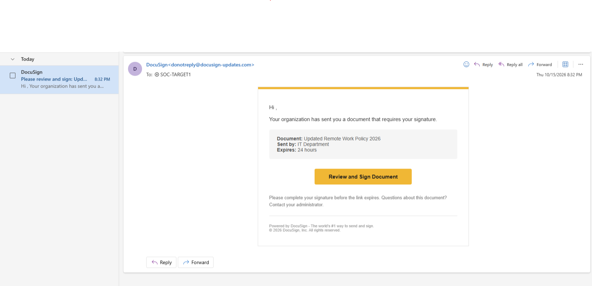
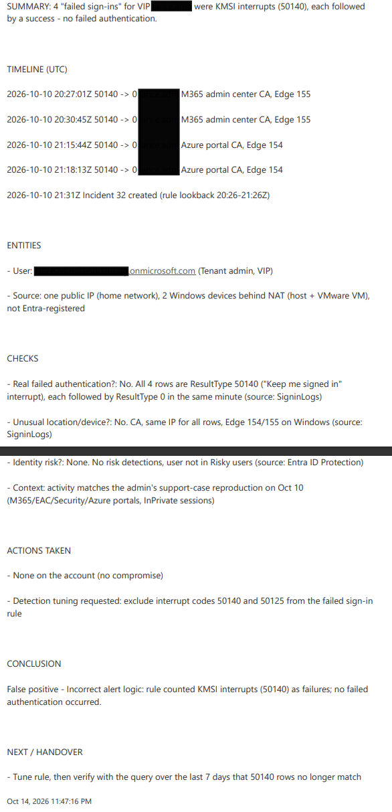

# Guide détaillé : SOC Lab · Microsoft Sentinel & Defender XDR

Le guide step-by-step complet du laboratoire, phase par phase.

```
Légende des encadrés :
> 💡 ELI5 = explication simple 
> 🔧 Leçon de ce build = ce qui m'a posé problème dans ce déploiement + le correctif
```

> 🧪 Lab CLEAN : domaine fictif `contoso.onmicrosoft.com`, comptes génériques, aucune donnée réelle, aucun secret, aucune IP.

---

Un laboratoire pratique couvrant l'ensemble des compétences d'analyste en opérations de sécurité, **bâti et testé de bout en bout dans un seul tenant**. Il garde une trace de ce qui a mal tourné en chemin, parce que ce sont ces moments-là qui apprennent le plus.


**Portails MS :**  
   - Defender → [security.microsoft.com](https://security.microsoft.com)  
   - Azure → [portal.azure.com](https://portal.azure.com)  
   - Microsoft 365 admin → [admin.microsoft.com](https://admin.microsoft.com)  
   - Entra → [entra.microsoft.com](https://entra.microsoft.com)  
   - Purview → [purview.microsoft.com](https://purview.microsoft.com)  


**Règles pour tout le lab**

- N'utiliser que des comptes et des VM jetables. Ne jamais lancer de test d'attaque sur ton PC quotidien.
- Garder chaque nom d'utilisateur, mot de passe et nom de ressource dans un fichier de notes.
- Prendre un instantané (snapshot) de la VM avant chaque test d'attaque.
- Arrêter (désallouer) les VM Azure à la fin de chaque session. C'est le plus gros levier de $ du lab.


**Nomenclature du déploiement :**

| Élément | Nom |
| --- | --- |
| Tenant/admin | `contoso.onmicrosoft.com` / `lab.admin` (Global Administrator) |
| Comptes de test | `soc.reader`, `soc.analyst`, `soc.engineer`, `soc.target1`, `soc.target2` |
| Groupe de ressources/workspace | `RG-SOC-LAB` / `law-soc` (East US) |
| VM Windows 11 locale (via VMware) | `CLOUD-W11`, dans le groupe d'appareils `Lab-Win` |
| VM Azure | `CLOUD-WINDOWS` (admin local `winadmin`), `CLOUD-UBUNTU` (utilisateur `linuxadmin`) |
| Préfixes de règles | `SR -` scheduled, `NRT -` near-real time, `CD -` détection custom, `AR -` règle d'automatisation, `PB-` playbook |

---

## Phase 0 : Licences, tenant et protections

L'essai Microsoft 365 E5 n'était pas offert au moment de la création de ce tenant, donc le lab assemble les mêmes pièces séparément : **Office 365 E5** (essai) + **Defender for Endpoint P2** (acheté pour un mois, un peu moins de 10$) + **Entra ID P2** (essai) + **Intune Plan 1** (essai, voir 1.5b).  

### 0.1 Acheter Defender for Endpoint P2 pour un mois

> **💡 ELI5**
>
> **Vois ça comme engager le gardien de sécurité pour un mois.** Defender for Endpoint est le gardien qui vit sur chaque ordinateur et surveille tout ce qu'il fait. P2 est la version qui tient un registre complet et qui peut agir : isoler une machine, collecter des preuves. Tu achètes un mois et tu l'annules directement après, afin qu'un deuxième mois ne te soit jamais facturé par accident.

1. admin.microsoft.com > **Marketplace** (ou Billing > Purchase services) > **Microsoft Defender for Endpoint P2**.
2. Durée d'abonnement **1 month**, facturation **Pay monthly**, quantité **1** (environ 8,52 $ CA avant taxes dans ce build). Ne jamais prendre les options 1 an ou 3 ans. **Buy**.
3. Immédiatement : Billing > **Your products** > sélectionne-le > **Renew or cancel this subscription > Cancel on expiration** > Save.
4. Users > Active users > `lab.admin` > **Licenses and apps** > coche **Defender for Endpoint P2** > Save.

### 0.2 Essai Entra ID P2

> **💡 ELI5**
>
> **Entra ID est la réceptioniste qui vérifie chaque badge pour valider ton accès ; P2 ajoute un expert en fraude à la réception.** Avec P2, Entra remarque les connexions étranges (un réseau anonyme, un trajet improbable) et marque l'utilisateur comme risqué (*Risky User*). Sans ça, tu vois seulement que quelqu'un s'est connecté, pas si ça avait l'air suspect. L'essai dure 30 jours, alors active-le juste avant d'en avoir besoin.

Entra admin center > **Billing > Licenses > Licensed features > Activate** sous Entra ID P2 (30 jours, 100 licences). Active-le peu avant la phase 2.5 pour que les 30 jours couvrent le travail d'identité des phases 2 à 4. Assigne-le à `lab.admin`, `soc.analyst` et `soc.target1`.

### 0.3 Mettre ton abonnement Azure dans le même tenant

> **💡 ELI5**
>
> **Sentinel et Defender doivent habiter dans le même immeuble pour se parler.** L'immeuble, c'est le tenant, ton organisation dans le cloud de Microsoft. L'abonnement Azure est ce qui paie Sentinel ; s'il est enregistré dans un autre tenant (immeuble), les deux ne peuvent pas se parler.

Sentinel ne se connecte à Defender XDR que lorsque les deux sont dans un même tenant. Si ton abonnement Azure vit dans un autre annuaire (ici : *Default Directory*), déplace-le pendant qu'il ne contient aucune ressource.

1. entra.microsoft.com en tant que `lab.admin` : **Users > Invite external user**, invite le compte propriétaire de l'abonnement, et accepte l'invitation.
2. portal.azure.com avec ce compte : **Subscriptions** > ton abonnement > **Change directory** > le tenant du lab. Ça peut prendre des heures.
3. Bascule vers l'annuaire du lab. Les anciennes attributions de rôle sont perdues, donc en tant que `lab.admin` active Entra ID > **Properties > Access management for Azure resources**, donne-toi **Owner** dans l'**Access control (IAM)** de l'abonnement, puis remets le réglage à off.
4. Solution de repli si Change directory est bloqué : crée un abonnement pay-as-you-go sous `lab.admin`, avec une alerte de budget d'abord.

### 0.4 Précautions

> **💡 ELI5**
>
> **Vois les comme une alarme sur ta carte de crédit.** Les essais deviennent discrètement des abonnements payants, et les VM coûtent de l'argent à chaque heure où elles tournent. Une alerte de budget et quelques rappels au calendrier font que tu l'apprends avant qu'il ne soit trop tard.

1. Azure **Cost Management > Budgets** : un petit budget avec des alertes à 50 % et 90 %.
2. Rappels au calendrier quelques jours avant la fin de chaque essai : « vérifier Billing > Your products ».

| Élément | Échéance | Renouvellement |
| --- | --- | --- |
| Essai Office 365 E5 | 30 jours après le début | Régler sur annulation à l'expiration |
| Defender for Endpoint P2 (acheté) | 1 mois après l'achat | Régler sur annulation à l'expiration |
| Essai Entra ID P2 | 30 jours après l'activation | Vérifier Your products |
| Essai Intune Plan 1 | 1 mois après l'activation | Régler sur annulation à l'expiration |
| Crédit Azure / pay-as-you-go | voir la facturation Azure | Vérifier Cost Management |

---

## Phase 1 : Fondations

### 1.1 Créer les comptes de test par rôle

> **💡 ELI5**
>
> **Un badge par métier, pour tester quelles portes chaque badge ouvre.** Un vrai SOC ne donne jamais la clé maîtresse à tout le monde. Ici `soc.reader` peut seulement regarder, `soc.analyst` gère les incidents, `soc.engineer` construit les règles, et `lab.admin` détient la clé maîtresse que tu n'utilises pas au quotidien. En 4.7 tu te connectes avec chacun et tu vérifies que les mauvaises portes restent verrouillées.

Un compte par rôle SOC, pour tester ce que chacun peut et ne peut pas faire. admin.microsoft.com > **Users > Active users > Add a user**, une fois par compte.

- **Licences :** Office 365 E5 pour les cinq. Ne jamais cocher **Defender for Endpoint P2** pour quelqu'un d'autre que `lab.admin` : cela achète une licence supplémentaire.
- **Optional settings > Roles > Admin center access :** coche le rôle Entra ci-dessous. Il est attribué immédiatement.
- **Mot de passe :** définis le tien (Edit > Let me create the password) et note-le quelque part.

| Compte | Rôle | Rôle Entra | Rôles Azure (1.6) |
| --- | --- | --- | --- |
| `lab.admin` | Admin du tenant, pas pour le quotidien | Global Administrator | Owner |
| `soc.reader` | Observateur en lecture seule (READ-ONLY) | Security Reader | Microsoft Sentinel Reader |
| `soc.analyst` | Triage et réponse | Security Operator | Microsoft Sentinel Responder + Playbook Operator |
| `soc.engineer` | Construit règles, connecteurs, classeurs, playbooks | Security Administrator | Microsoft Sentinel Contributor + Logic App Contributor |
| `soc.target1`, `soc.target2` | Utilisateurs ordinaires que nous allons attaquer | aucun | aucun |

### 1.2 Créer le workspace Sentinel

> **💡 ELI5**
>
> **Le workspace Log Analytics est l'entrepôt ; Sentinel est l'équipe de sécurité qui travaille dedans.** Chaque journal que tu collectes est stocké dans le workspace. Sentinel ajoute l'analyse par-dessus : des règles qui lisent les journaux, des incidents, de l'automatisation. Le connecter au portail Defender met tout sur un seul écran au lieu de deux.

1. Azure portal > **Log Analytics workspaces > Create**. Groupe de ressources : nouveau `RG-SOC-LAB`. Nom `law-soc`. Région : la plus proche de toi (East-US dans mon cas). Create.
2. **Microsoft Sentinel > Create** > sélectionne `law-soc` > **Add**.
3. Portail Defender : cherche **Microsoft Sentinel** dans le menu de gauche. En tant qu'Owner de l'abonnement, le workspace est généralement onboardé automatiquement. Sinon : **System > Settings > Microsoft Sentinel > Connect a workspace** > `law-soc` > marque-le **Primary**.

À partir d'ici, le lab utilise le portail Defender (la plateforme SecOps unifiée) pour Sentinel partout où c'est possible. Fort.  

### 1.3 Construire la machine de test Windows 11 (VMware, sur ton propre ordinateur)

> **💡 ELI5**
>
> **Un mannequin d'entraînement.** Une VM sur ton propre PC est un ordinateur jetable que tu peux attaquer, remplir de fichiers de test et restaurer. Le `clean` snapshot est ton point de départ/sauvegarde : si quelque chose tourne mal, tu y reviens en un clique.  

Une VM locale économise du crédit Azure et démontre un onboarding de style *on-prem*, par opposition aux VM Azure de la phase 2.

1. Télécharge l'**ISO de Windows 11 Enterprise**.
2. VMware Workstation Player : 4 Go de RAM, 60 Go de disque, réseau NAT (la box a besoin d'un accès Internet sortant).
3. Installe Windows avec un compte admin local, puis prends un instantané appelé `clean` avant d'onboarder quoi que ce soit.

### 1.4 L'onboarder dans Defender for Endpoint

> **💡 ELI5**
>
> **Onboarder, c'est donner une radio au gardien.** Le capteur de Defender est déjà intégré à Windows ; le script d'onboarding lui dit à quelle organisation faire rapport. Le test de détection est une fausse alarme pour vérifier que la radio fonctionne : si une alerte de test apparaît dans le portail, la machine parle à Defender.

1. Portail Defender > **System > Settings > Endpoints > Device management > Onboarding**.
2. **Windows 10 and 11**, méthode de déploiement **Local Script** > **Download onboarding package**.
3. Dans la VM : extrais le zip, clic droit sur `WindowsDefenderATPLocalOnboardingScript.cmd` > **Run as administrator** > **Y**.
4. Copie la commande de **detection test** depuis la même page et exécute-la dans la VM.
5. En 30 minutes environ : l'appareil apparaît dans **Assets > Devices**, et une alerte de test apparaît dans **Incidents & alerts**.

### 1.5 Configurer Defender for Endpoint

> **💡 ELI5**
>
> **Maintenant tu donnes des instructions au gardien.** Les fonctionnalités avancées décident ce que le gardien a le droit de faire, comme ouvrir un shell à distance ou bloquer de lui-même. Le groupe d'appareils décide jusqu'où il peut aller sans demander (ici : corriger les menaces automatiquement). Les notifications décident qui est appelé quand quelque chose arrive.

1. **Advanced features** (Settings > Endpoints > General) : active **Live Response**, **Live Response for unsigned scripts** et **EDR in block mode**. Laisse *Automatically resolve alerts* activé. Note les autres interrupteurs (Custom network indicators, Tamper protection, Microsoft Intune connection). Save.
2. **Device group** (Settings > Endpoints > Permissions > **Device groups > Add**) : nom `Lab-Win`, règle de correspondance **Name starts with** `CLOUD-W11` AND **OS in** Windows 11, niveau d'automatisation **Full - remediate threats automatically**, aucun groupe d'accès utilisateur. Save, et vérifie que `Lab-Win` est **Rank 1**, au-dessus de *Ungrouped devices*. L'appartenance peut prendre 15-30+ minutes (dans mon cas, du moins).
3. **Email notifications**, vers une adresse que tu lis vraiment :
   - **Alerts :** Settings > Endpoints > General > **Email notifications** > ajoute une règle (`Lab-Alerts-All`), tous les appareils, toutes les sévérités (les alertes de test sont Informational), *Include device information* activé. Si la page a aussi un onglet **response actions**, ajoute-y une règle également.
   - **Incidents :** Settings > Microsoft Defender XDR > **Email notifications > Incidents** > ajoute une règle : toutes les sévérités, statuts et sources.
   - **Threat analytics :** même page > onglet **Threat analytics** > ajoute une règle (nom en lettres et chiffres seulement, p. ex. `LABTHREATALL`), tous les rapports nouveaux et mis à jour.
4. **Règles ASR en mode audit :** Endpoints > **Configuration management > Endpoint security policies > Create new policy** > Windows > *Attack surface reduction rules*. Nom `LabASRAudit`. Mets **chaque règle sur Audit** (l'audit ne bloque jamais) et **Controlled folder access** sur **Audit mode**. Assigne-la à un groupe d'appareils (nécessite Intune, voir 1.5b).
5. **Alert tuning :** Settings > Microsoft Defender XDR > **Alert tuning**. Ouvre les règles intégrées et le formulaire *Add rule* (masquer ou résoudre les alertes qui correspondent à des conditions). N'en crée pas encore : il n'y a pas d'alertes bruyantes à ajuster.
6. **Automated investigation et attack disruption :** l'AIR est piloté par le niveau d'automatisation de chaque groupe d'appareils (étape 2). L'attack disruption est activé par défaut. Ses actions, et celles de l'AIR, apparaissent dans l'**Action center**, qu'on regardera plus en détail en 4.4.

### 1.5b Enrôlement Intune

> **💡 ELI5**
>
> **Intune est le service TI qui livre les réglages à chaque PC.** Defender peut écrire des politiques de sécurité, mais c'est Intune qui les transporte jusqu'à la machine. Enrôler la VM fait que les règles de réduction de la surface d'attaque l'atteignent vraiment, au lieu de rester sur papier.

Nécessaire pour que la politique ASR s'applique réellement à `CLOUD-W11`.

1. **Licence :** Office 365 E5 n'inclut pas Intune. Marketplace > **Microsoft Intune Plan 1 (Trial)**, la ligne étiquetée TRIAL (pas la ligne payante ni *Device*). Annulation à l'expiration, assigne à `lab.admin`.
2. **Connecter Defender for Endpoint et Intune :** portail Defender > Settings > Endpoints > Advanced features > **Microsoft Intune connection** > On > Save. Puis dans Intune > Endpoint security > Microsoft Defender for Endpoint, **Refresh** jusqu'à ce que la connexion affiche **Available**, active *Allow Microsoft Defender for Endpoint to enforce Endpoint Security Configurations* et l'interrupteur de conformité Windows, Save.
3. **Portée MDM :** Entra > Mobility (MDM and MAM) > Microsoft Intune > MDM user scope **Some** > un groupe contenant `lab.admin` (`SOC-LAB` ici) > Save.
4. **Enrôler depuis l'intérieur de la VM :** Settings > Accounts > Access work or school > **Connect** > connecte-toi comme `lab.admin`. Un **Sync** manuel sur la même page accélère son apparition dans Intune.
5. De retour dans les **Assignments** de la politique ASR : tape `SOC-LAB` dans la recherche de groupe, sélectionne le groupe, enregistre. Vérifie sur la VM, en PowerShell admin :

```
Get-MpPreference | Select-Object -ExpandProperty AttackSurfaceReductionRules_Ids
```

Chaque GUID de règle ASR devrait être listé (17 dans ce build ; Microsoft en ajoute avec le temps).

### 1.6 Attribuer les rôles Sentinel

> **💡 ELI5**
>
> **Les badges pour l'immeuble de l'équipe de sécurité.** Sentinel vit dans Azure, donc ses permissions sont des rôles Azure sur le groupe de ressources. Ils viennent en paires parce que les playbooks vivent dans un immeuble **séparé** (Logic Apps) : avoir le droit de gérer les incidents ne veut pas dire qu'on a le droit de démarrer le robot qui les traite.

`RG-SOC-LAB` > **Access control (IAM) > Add > Add role assignment**, en utilisant la colonne « Rôles Azure » du tableau 1.1.

- **Pourquoi les paires :** les playbooks sont des Logic Apps, une ressource Azure séparée. Sentinel Contributor construit tout à l'intérieur de Sentinel, mais modifier un playbook nécessite **Logic App Contributor**. De même, Responder gère les incidents, mais exécuter un playbook depuis un incident nécessite **Playbook Operator**.
- **Type d'attribution :** le portail propose par défaut **Eligible** + **Time bound** (style PIM). Pour le lab, choisis **Active** + **Permanent**, sinon chaque compte doit activer son rôle avant de l'utiliser (pas la meilleure pratique, mais pertinent dans un lab disons).

---

## Phase 2 : Ingérer les données

2 modèles de déploiement :

- **VM Azure** (`CLOUD-WINDOWS`, `CLOUD-UBUNTU`) : ingestion cloud-native avec l'**Azure Monitor Agent (AMA)** et des **data collection rules (DCR)**.
- **Windows 11 local** (`CLOUD-W11`) : onboarding Defender for Endpoint. Sa télémétrie reste dans Defender XDR, sauf si tu ajoutes AMA via Azure Arc (*on-prem*)(2.2b).

**L'endroit où vivent tes données** décide quel outil peut les utiliser.  
Free tip = Garde ce tableau en tête pour tout le lab :  

| Donnée | Stockée dans | Interrogée via | Utilisable par |
| --- | --- | --- | --- |
| Données de connecteur : `SecurityEvent`, `Syslog`, `SigninLogs`, `AzureActivity`, `ThreatIntelIndicators`, tables custom `_CL` | Workspace Sentinel (`law-soc`) | Log Analytics (Azure) et Advanced hunting (Defender) | Règles analytiques Sentinel, classeurs, hunting |
| Tables Defender XDR : `Device*`, `Email*`, `Identity*` | Defender XDR (environ 30 jours) | Advanced hunting seulement, sauf si streamées vers le workspace | Détections custom Defender, Advanced hunting (et UEBA pour `DeviceLogonEvents`, voir 3.3b) |

2 habitudes qui font gagner du temps : les tables Defender utilisent `Timestamp` et les tables du workspace utilisent `TimeGenerated` ; et Log Analytics affiche les heures en **UTC** tandis que les pages des portails affichent souvent l'heure locale.

### 2.1 Créer les VM Azure

> **💡 ELI5**
>
> **Deux autres ordinateurs de test, cette fois loués dans le cloud.** Un Linux, un Windows, pour collecter les deux types de journaux. Ils sont sur Internet, donc le premier travail est de verrouiller la porte : SSH et RDP seulement depuis ta propre adresse, et extinction automatique pour qu'ils ne tournent (et ne facturent) pas toute la nuit.

1. **Ubuntu :** Virtual machines > Create. Groupe de ressources `RG-SOC-LAB`, même région, image *Ubuntu Server 24.04 LTS*, la plus petite taille disponible, disponibilité *No infrastructure redundancy required*. Authentification : SSH public key, nouvelle paire de clés, **télécharge le .pem immédiatement** (téléchargement unique). Nom `CLOUD-UBUNTU`.
   - **Networking :** nouvelle IP publique, NSG de la NIC **Basic**, entrant **SSH (22)** (le portail avertit que c'est ouvert sur Internet ; tu corriges ça ci-dessous). Coche *Delete public IP and NIC when VM is deleted*.
   - **Management :** active **Auto-shutdown**.
   - **Après la création :** VM > Networking > la règle entrante SSH > Source **IP Addresses** = ton IP publique avec `/32`.
   - Connexion : `ssh -i CLOUD-UBUNTU_key.pem <user>@<VM public IP>`.
2. **Windows Server :** même modèle, image *Windows Server 2022 or 2025 Datacenter*, nom d'utilisateur et mot de passe d'admin local (pas `Administrator` ou `Admin` please), **RDP (3389)** restreint à ton IP. Nom `CLOUD-WINDOWS`. Il coûte plus cher à l'heure qu'Ubuntu parce que la licence Windows est incluse, c'est normal.  

### 2.2 Événements de sécurité Windows via AMA

> **💡 ELI5**
>
> **AMA est le livreur ; la DCR est le bon de livraison.** L'Azure Monitor Agent est installé sur la VM et ramasse les événements de sécurité Windows. La data collection rule dit quels événements prendre et où les livrer (ton workspace). Aucune ligne dans la table = aucune livraison, peu importe ce que dit la page du connecteur.

1. Portail Defender > Microsoft Sentinel > **Content management > Content hub** > **Windows Security Events** > **Install**.
2. **Configuration > Data connectors** > **Windows Security Events via AMA** > **Open connector page** > **Create data collection rule** : nom `DCR-WINDOWS-EVENTS`, ressource `CLOUD-WINDOWS`, jeu d'événements **Common**.
3. Après 15+ minutes, vérifie :

```kql
SecurityEvent                              // Windows security events (via AMA)
| where Computer contains "CLOUD-WINDOWS"  // the Azure Windows VM only
| take 10                                  // any rows = data is flowing
```

Si c'est vide, connecte-toi en RDP et génère de l'activité (`whoami /all`, `net user`, un mauvais mot de passe, etc.), puis relance la requête.

### 2.2b AMA sur la VM Windows 11 locale via Azure Arc (optionnel)

> **💡 ELI5**
>
> **Arc est un badge visiteur pour les machines hors Azure.** Il permet à Azure de traiter ta VM locale comme l'une de ses propres ressources, pour que le même livreur (AMA) et le même bon de livraison (DCR) fonctionnent dessus. Même table au bout, une autre porte d'entrée.

1. Azure portal > **Azure Arc > Servers > Add > Generate script**, et exécute-le en admin dans la VM. Il installe le Connected Machine agent.
2. Une fois la machine *Connected*, ajoute-la comme ressource sur `DCR-WINDOWS-EVENTS`.
3. Compare les lignes `SecurityEvent` de `CLOUD-WINDOWS` et `CLOUD-W11` : même table, deux chemins d'onboarding.
4. Arc en soi est gratuit. N'attache pas de plan Defender for Cloud payant.

### 2.3 Syslog via AMA

> **💡 ELI5**
>
> **Même livreur, MAIS courrier Linux.** Syslog est le registre de Linux. Tu choisis quelles sections collecter (connexions, sudo, tâches planifiées) et à quel point un message doit être grave pour être ramassé. Tout le reste reste == *none*, pour ne pas payer à stocker du noise inutile.

1. Content hub : installe **Syslog**. Data connectors > **Syslog via AMA** > **Create data collection rule** : `DCR-SYSLOG`, ressource `CLOUD-UBUNTU` (une VM Azure, donc pas besoin d'Arc).
2. Onglet **Collect** : chaque facility est à *none* par défaut. Mets `LOG_AUTH` et `LOG_AUTHPRIV` → **LOG_INFO** (connexions, sudo, SSH), `LOG_CRON` → **LOG_INFO** (tâches planifiées, une technique de persistance, T1053.003), `LOG_DAEMON` → **LOG_WARNING**. Laisse le reste à none.
3. Attends 10-15 minutes, puis génère de l'activité : connecte-toi en SSH, `sudo whoami`, une connexion échouée, et une tâche cron jetable :

```bash
(crontab -l 2>/dev/null; echo "*/5 * * * * echo test") | crontab -
# after it shows up in Syslog, remove it:
crontab -r
```

```kql
Syslog                                                      // Linux syslog (via AMA)
| where Facility in ("auth", "authpriv", "cron", "daemon")  // the facilities the DCR collects
| take 20                                                   // sample rows
```

**CEF via AMA** fonctionne de la même façon mais nécessite un appareil qui envoie du CEF (pare-feu, IDS, etc.) vers un forwarder Linux. Ce lab n'en a aucun, donc c'est couvert conceptuellement seulement. Un connecteur sans rien derrière n'apprend rien.

### 2.4 Journaux d'activité Azure

> **💡 ELI5**
>
> **Le journal d'activité Azure est le registre des visiteurs de l'immeuble.** Il enregistre qui a créé, modifié ou supprimé quoi dans ton abonnement. Azure Policy est la règle « chaque abonnement envoie son registre au workspace » ; la tâche de remédiation applique cette règle à ce qui existe déjà, pas seulement à ce que tu crées ensuite.

1. Content hub : installe **Azure Activity**. Ouvre le connecteur > **Launch Azure Policy Assignment wizard**.
2. Portée : ton abonnement. Paramètres : `law-soc`, toutes les catégories de journaux à True. Onglet **Remediation** : coche **Create a remediation task**. Une politique n'agit automatiquement que sur les ressources créées ou modifiées après son attribution ; la tâche de remédiation est ce qui l'applique à ton abonnement existant.
3. Alternative, aussi à l'examen : Azure > **Monitor > Activity log > Export Activity Logs > Add diagnostic setting**, toutes les catégories, envoie à `law-soc`.
4. Vérifie après 15-60 minutes (démarre ou arrête une VM pour créer des événements) :

```kql
AzureActivity                                                             // subscription activity log
| where TimeGenerated > ago(1d)                                           // last day
| project TimeGenerated, OperationNameValue, Caller, ActivityStatusValue  // what, who, result
```

### 2.5 Defender XDR, Entra ID et un threat indicator

> **💡 ELI5**
>
> **Brancher les alarmes que tu possèdes déjà.** Defender XDR lève déjà des incidents ; dans le portail unifié, ils arrivent dans Sentinel sans configuration. Le connecteur Entra apporte les journaux de connexion : qui s'est connecté, d'où, et si ça a marché. Le threat indicator est un avis de recherche : si cette IP apparaît un jour dans tes journaux, une règle peut la signaler.

**Connecteur Defender XDR :** une fois le workspace onboardé au portail Defender, les incidents et alertes arrivent automatiquement et il n'y a rien à connecter. Vérifie quels produits envoient des incidents :

```kql
SecurityIncident                     // incidents synced to the workspace
| summarize count() by ProviderName  // expect "Microsoft XDR" once Defender incidents exist
```

Installer la solution **Microsoft Defender XDR** depuis le Content hub est optionnel et sans danger : elle ajoute des modèles de règles, des requêtes de hunting et des classeurs, pas une deuxième connexion. Ne change pas les réglages d'incidents du connecteur, et ne crée pas de règles *Microsoft Security* (incident creation) : Defender XDR crée déjà ces incidents, ce serait redondant.

1. **Connecteur Entra ID :** Data connectors > **Microsoft Entra ID** > coche **Sign-in logs** et **Audit logs** > Apply.
2. **Indicateur de menace :** portail Defender > **Threat intelligence > Intel management > Create > Indicator**. IPv4 `203.0.113.10` (une plage de documentation, jamais une adresse réelle), un nom, type *Malicious Activity*, dates de validité, confiance environ 70. Save. *Intel profiles* et *Intel explorer* au-dessus sont le flux de Microsoft et peuvent afficher « No access » ; c'est attendu.
3. Vérifie les deux (une requête à la fois) :

```kql
SigninLogs | take 5  // Entra sign-ins arriving?
```

```kql
ThreatIntelIndicators                    // current TI table (STIX pattern in Pattern)
| where Pattern contains "203.0.113.10"  // your indicator
```

**Tables Defender** (Advanced hunting, une fois `CLOUD-W11` onboardé) : `DeviceInfo | take 10`, puis `DeviceProcessEvents | take 10`.

### 2.6 Table de journaux personnalisée (_CL)

> **💡 ELI5**
>
> **Ton propre formulaire, pour des données qu'aucun connecteur ne connaît.** Quand une source n'a pas de connecteur prêt à l'emploi, tu conçois la table toi-même, puis tu bâtis le chemin vers elle : le DCE est l'adresse postale, la DCR est la règle de tri, et la table `_CL` est le classeur au bout.

Pour les sources de données sans connecteur intégré.

1. Enregistre un échantillon dans `lab.json` :

```json
[
  { "TimeGenerated": "2026-09-26T10:00:00Z", "EventType": "TestEvent", "Source": "Lab", "Message": "Sample custom log entry" },
  { "TimeGenerated": "2026-09-26T10:05:00Z", "EventType": "TestEvent", "Source": "Lab", "Message": "Second sample entry" }
]
```

2. **Crée d'abord un data collection endpoint (DCE) :** Azure portal > **Data collection endpoints > Create**, `RG-SOC-LAB`, nom `dce-soc-eastus`, **même région que le workspace**. Sans lui, l'assistant de table dit « No data collection endpoints were found in this region ».
3. Azure portal > `law-soc` > **Tables > Create > New custom log (DCR-based)**. Nom `LabCustomEvents` (il devient `LabCustomEvents_CL`), sélectionne le DCE, crée une nouvelle DCR (`DCR-LabCustom`), téléverse `lab.json` comme échantillon de schéma, Create.
4. Vérifie dans Log Analytics du portail Azure : `LabCustomEvents_CL | getschema` liste tes quatre colonnes plus `TenantId`, `Type` et `_ResourceId`.

L'échantillon ne fait que définir les colonnes ; ses lignes ne sont pas ingérées, donc la table reste vide. Les données n'arrivent que lorsqu'une source poste du JSON vers la **Logs Ingestion API** via le DCE, authentifiée comme une application ayant **Monitoring Metrics Publisher** sur la DCR. Comprendre ce pipeline est l'objectif.

### 2.7 Rétention et data lake

> **💡 ELI5**
>
> **La rétention, c'est combien de temps tu gardes les fichiers, et où.** Les 90 premiers jours restent sur le bureau (analytics tier) : rapides à chercher (scheduled, RT, ML, etc.) et inclus avec Sentinel. Après ça, les journaux peuvent aller à l'archive (le data lake) : moins cher, mais plus lent à fouiller (summary rules). Tu choisis par table, selon la fréquence à laquelle tu en auras besoin.

1. **Rétention de table :** `law-soc` > Tables > n'importe quelle table > **…** > **Manage table**. Regarde la **analytics (interactive) retention** et la **total retention**. Un workspace Sentinel inclut 90 jours de rétention analytique sans coût de rétention supplémentaire ; au-delà, les données peuvent être conservées à long terme à moindre prix, mais sont plus lentes et plus limitées à interroger.
2. **Data lake :** cherche une option d'onboarding au data lake Sentinel (System > Settings, la page d'accueil de Sentinel). Non disponible pour ce tenant : aucune option d'onboarding n'est apparue nulle part, probablement une limite de région ou d'essai.

---

## Phase 3 : Détections et automatisation

**Avant chaque session :** démarre `CLOUD-WINDOWS` (Azure) et `CLOUD-W11` (VMware). Les règles ne se déclenchent que sur des données qui arrivent. Arrête la VM Azure quand tu as fini.

**Construis, puis teste tout de suite.** Chaque règle a une étape *Test now*. Prouver une règle à la fois est bien plus facile que d'en déboguer cinq plus tard, et la phase 4 investigue alors des incidents que tu sais réels.

**Descriptions de règles :** donne à chaque règle une description de la même forme : *QUOI* elle détecte, *POURQUOI* ça compte (technique ATT&CK), *COMMENT* elle fonctionne (source, planification), étapes de *TRIAGE*. Elle apparaît sur chaque alerte, donc elle sert aussi de notes de révision.

### 3.1 Règle analytique scheduled

> **💡 ELI5**
>
> **Une règle scheduled/planifiée est un gardien qui fait des rondes.** Toutes les quelques minutes, elle exécute une requête sur la dernière tranche de journaux ("plus de 5 connexions échouées depuis un même endroit ?") et lève une alerte si la réponse est oui. Le mappage d'entités lui dit ce qu'est chaque colonne (un utilisateur, un hôte, une IP), pour que les alertes liées soient regroupées en un seul incident.

1. Microsoft Sentinel > **Configuration > Analytics > Create > Scheduled query rule**.
2. **General :** `SR - MULTIPLE FAILED LOGONS`, sévérité Medium, tactique Credential Access, technique **T1110 Brute Force**.
3. **Rule query :**

```kql
SecurityEvent                                                     // Windows security events
| where EventID == 4625                                           // failed logons only
| summarize Failures = count(), LastFailure = max(TimeGenerated)  // count + time of the last failure...
    by Account, TargetUserName, IpAddress, Computer               // ...per account, source IP and host
| where Failures > 5                                              // brute-force threshold (6 or more)
```

4. **Entity mapping** dit à Sentinel ce qu'est chaque colonne, ce qui alimente les pages d'entités, le graphe d'incident et la corrélation entre alertes. Choisis l'identifiant qui correspond au format de la valeur :
   - Account : **FullName** = `Account` (forme `DOMAIN\user`), plus **Name** = `TargetUserName` (nom d'utilisateur nu).
   - IP : **Address** = `IpAddress`. Host : **HostName** = `Computer`.
5. **Custom details :** `Failures` → `Failures`. **Alert name format :** `{{Failures}} failed logons for {{TargetUserName}} from {{IpAddress}}`. **Alert description format** (3 placeholders au maximum) : `Failed logons (4625) for {{Account}} on {{Computer}} from {{IpAddress}}. Check for a successful 4624 from the same IP afterwards.`
6. **Query scheduling :** exécute toutes les **5 minutes**, regarde **10 minutes** en arrière (vérifie que les listes d'unités disent Minutes). Seuil : supérieur à 0. **Event grouping :** *Trigger an alert for each event*. Suppression off.
7. **Incident settings :** create incidents Enabled. Laisse Automated response vide (3.4). Create.

**Test now :** connecte-toi en RDP à `CLOUD-WINDOWS` comme `.\winadmin` avec un mauvais mot de passe 6+ fois en 2 minutes environ, puis connecte-toi. Laisse environ 15 minutes. Si rien n'apparaît, vérifie que les événements sont arrivés et comment ils sont répartis :

```kql
SecurityEvent                                                      // Windows security events
| where TimeGenerated > ago(3h) and EventID == 4625                // failed logons, last 3 hours
| summarize Failures = count() by bin(TimeGenerated, 5m), Account  // per 5-minute bin and account
```

### 3.2 Règle NRT

> **💡 ELI5**
>
> **Une règle NRT est un détecteur de mouvement au lieu de rondes.** Elle s'exécute chaque minute sur les données les plus récentes, pour les événements où les minutes comptent, comme l'apparition d'un nouveau compte. Le compromis : moins d'options qu'une règle planifiée.

1. Analytics > **Create > NRT query rule** : `NRT - USER ACC CREATED`, sévérité Low, tactique Persistence, technique **T1136 Create Account**.
2. Requête :

```kql
SecurityEvent                                                                     // Windows security events
| where EventID == 4720                                                           // a user account was created
| project TimeGenerated, Computer, SubjectAccount, TargetAccount, TargetUserName  // when, where, who created whom
```

3. Entités : Account FullName = `TargetAccount` (nouveau compte), un second Account FullName = `SubjectAccount` (créateur), Host HostName = `Computer`. Alert name format : `{{TargetAccount}} created by {{SubjectAccount}} on {{Computer}}`.
4. Il n'y a pas de section de planification : les règles NRT s'exécutent chaque minute.

**Test now** (invite admin sur `CLOUD-WINDOWS`). `/add` est requis : sans lui, la commande essaie de changer le mot de passe d'un compte qui n'existe pas.

```
net user labtemp1 "P@ssword-Lab2026" /add
rem after the alert appears, clean up (logs event 4726):
net user labtemp1 /delete
```

### 3.2b Watchlist et une règle VIP

> **💡 ELI5**
>
> **Une watchlist est une liste sur le bloc-notes du gardien.** Dans notre déploiement, elle dit précisément "ces comptes sont des VIP". La règle ne regarde que les échecs de connexion des gens sur la liste, et en sévérité **High**, parce qu'un échec sur le compte admin compte plus qu'un sur celui d'un stagiaire.

1. Enregistre sous `lab-vips.csv` (Notepad : *Save as type: All files*, pour qu'il ne soit pas enregistré en `.csv.txt`) :

```
UserPrincipalName,Role
soc.target1@contoso.onmicrosoft.com,Finance VIP
lab.admin@contoso.onmicrosoft.com,Tenant admin
```

2. Sentinel > **Configuration > Watchlist > New** : nom et alias `LabVIPs`, source *Local file*, CSV avec un en-tête, 0 ligne avant l'en-tête, téléverse, **SearchKey** = `UserPrincipalName`. Create, attends une minute ou deux, et vérifie que `_GetWatchlist('LabVIPs')` renvoie les deux lignes *avant* de construire la règle.
3. Règle planifiée `SR - VIP SIGN-IN FAILURES`, sévérité High, Credential Access, T1110 :

```kql
let vips = _GetWatchlist('LabVIPs')                                                   // load the VIP watchlist as "vips"
    | project UserPrincipalName = tolower(SearchKey), Role;                           // UPN (lower-cased) + Role; ";" ends the let
SigninLogs                                                                            // all Entra sign-ins in the lookback
| where ResultType !in ("0", "50140", "50125")                                        // real failures only: not success ("0", a string) or interrupts (50140, 50125)
| extend UserPrincipalName = tolower(UserPrincipalName)                               // lower-case to match the watchlist
| join kind=inner vips on UserPrincipalName                                           // keep VIPs only, add their Role
| summarize Failures = count(), IPs = make_set(IPAddress) by UserPrincipalName, Role  // count + distinct source IPs per VIP
| where Failures >= 3                                                                 // alert on 3+ failures
```

4. Entité : Account FullName = `UserPrincipalName`. Custom details : `Failures`, `Role`. Alert name format : `{{Failures}} failed sign-ins for VIP {{UserPrincipalName}} ({{Role}})`.
5. Planification : toutes les **15 minutes**, regarde **1 heure** en arrière (les journaux de connexion arrivent plus lentement que les événements Windows). **Suppression activée, 1 heure** : sinon les fenêtres qui se chevauchent alerteraient jusqu'à quatre fois sur une seule rafale.

**Test now :** fenêtre de navigation privée, office.com, `soc.target1`, 3-4 mauvais mots de passe (moins de 10 évite le smart lockout), puis le bon. Laisse jusqu'à 30 minutes.

> **🔧 Leçon de ce build**
>
> - **Incident 32, « 4 failed sign-ins for VIP lab.admin (Tenant admin) ».** Les quatre lignes étaient des ResultType `50140` = *"Stay signed in?"*, et chacune était suivie d'un `0` dans la même minute. Le mot de passe et la MFA étaient déjà passés : rien n'avait échoué. Contexte : une IP résidentielle, 2 machines du lab (Edge 155 et 154 derrière NAT), pendant le travail sur le dossier de support. Rien dans ID Protection.
> - **Les interruptions ne sont pas des échecs.** `ResultType != "0"` compte aussi les écrans supplémentaires qu'Entra journalise en cours de connexion : `50140` (Stay signed in?), `50125` (inscription à la réinitialisation de mot de passe), `50074`/`50076` (MFA requise). L'invite KMSI (*keep me signed in*) apparaît chaque fois qu'il n'y a pas de cookie persistant : InPrivate, un nouveau navigateur, une nouvelle VM, ou répondre Non. La règle se déclenchait donc sur du travail d'admin ordinaire.
> - **Le correctif : optimiser la règle** (la requête ci-dessus exclut maintenant `50140` et `50125`). `50074`/`50076` restent volontairement : après un password spray, ils signifient que le mot de passe était *correct*. Les vrais échecs comme `50126` (mauvais mot de passe), `50053` (verrouillé) et `50057` (désactivé) comptent toujours. Vérifie en exécutant la requête sur 7 jours : aucune ligne `50140` ne devrait correspondre.
> - **Classification : False positive > Incorrect alert logic**, pas Benign positive. Benign positive veut dire que l'alerte était juste et que l'activité était attendue (un test de lab). False positive veut dire que l'alerte elle-même était fausse : les 4 échecs n'ont jamais eu lieu, plutôt une mauvaise configuration.
> - **Pourquoi c'est important : ALERT FATIGUE**. Une règle qui se déclenche surtout sur du bruit entraîne le SOC à la fermer sans regarder, et le vrai password spray se fait fermer de la même façon = danger.

### 3.3 Détection personnalisée dans Defender XDR

> **💡 ELI5**
>
> **La même idée qu'une Analytic Rule, mais du côté de Defender.** Les tables propres à Defender (processus, fichiers et connexions de chaque appareil) restent dans Defender, donc une règle qui les lit se construit depuis Advanced hunting. Le bonus : quand elle se déclenche, elle peut agir sur l'appareil tout de suite, comme collecter un paquet d'investigation.

Les tables Defender comme `DeviceProcessEvents` ne sont pas dans le workspace Sentinel (2.5), donc cette détection est une **custom detection** Defender XDR, construite depuis Advanced hunting.

1. **Génère des données :** sur `CLOUD-W11` exécute `powershell -enc VwByAGkAdABlAC0ASABvAHMAdAAgACIAbABhAGIAIgA=`. Ça se décode en `Write-Host "lab"` et print simplement *lab*. Attends 5-10 minutes.
2. **Hunting > Advanced hunting**, plage de temps 24 heures.

```kql
DeviceProcessEvents                                                                                                  // Defender process launches
| where FileName in~ ("powershell.exe", "pwsh.exe")                                                                  // Windows PowerShell or PowerShell 7
| where ProcessCommandLine matches regex @"(?i)\s-e(nc|ncodedcommand)?\s"                                            // -e / -enc / -encodedcommand switch
| project Timestamp, DeviceId, DeviceName, ReportId, AccountSid, ProcessCommandLine, ProcessId, ProcessCreationTime  // Timestamp, ReportId, DeviceId required
```

3. Avec un résultat affiché, clique **Create detection rule** :
   - **General :** `CD - ENCODED POWERSHELL`, fréquence **Every hour**, sévérité Medium, catégorie Execution, technique **T1059.001**. Lier un rapport de threat analytics est optionnel ; dans notre cas, aucun ne convient à une technique générique.
   - **Alert settings :** titre `Encoded PowerShell on {{DeviceName}}`. Description (requise) : `Command: {{ProcessCommandLine}}` plus tes lignes QUOI/POURQUOI/TRIAGE.
   - **Impacted assets :** Device = `DeviceId`, User (Sid) = `AccountSid`. **Related evidence :** un Process, CommandLine = `ProcessCommandLine`.
   - **Custom details :** `ProcessId`, `ProcessCreationTime` (ils identifient précisément cette exécution de processus dans la timeline de l'appareil).
   - **Automated actions :** seulement **Collect investigation package**. L'isolation se fait délibérément en 4.4, pas à chaque test PowerShell. **Scope :** groupe d'appareils `Lab-Win`.
4. Submit. Gère-la sous **Hunting > Custom detection rules** (statut de dernière exécution, alertes déclenchées, modifier, exécuter, désactiver).

### 3.3b Threat intelligence, UEBA, anomalies, MITRE ATT&CK

> **💡 ELI5**
>
> **Des règles que tu n'as pas à écrire.** La threat intelligence (TI) compare tes journaux à des IP et domaines **CONNUS** comme malveillants. L'UEBA apprend ce qui est normal pour chaque utilisateur (typique) et signale ce qui ne l'est pas (atypique). Les règles d'anomalie et de ML font pareil pour des motifs comme des connexions RDP inhabituelles. MITRE ATT&CK est le framework qui montre quelles techniques d'attaque tu couvres.

**Corresponds à ton propre indicateur.** Les règles analytiques n'interrogent que le workspace, donc le modèle *TI map* doit utiliser une table que tu ingères vraiment.

1. Content hub : confirme que la solution **Threat Intelligence** est installée et à jour.
2. Analytics > **Rule templates** > **TI map IP entity to SigninLogs** > Create rule. Vérifie que sa requête utilise `ThreatIntelIndicators`.
3. `203.0.113.10` n'apparaît jamais dans les connexions, alors ajoute un second indicateur pour ton **IP publique résidentielle** (`SigninLogs | top 1 by TimeGenerated | project IPAddress`), description *Lab test: home IP*, **valide jusqu'à demain**. Les indicateurs restent privés à ton workspace : ils ne sont pas partagés avec Microsoft ni d'autres tenants et ne bloquent rien.
4. **Test now :** connecte-toi à office.com comme `soc.target1`. Les modèles TI s'exécutent moins souvent ; laisse une heure ou deux.
5. Crée aussi la règle **Microsoft Defender Threat Intelligence Analytics** (filtre Rule type = Threat Intelligence). Elle correspond au flux de Microsoft, pas au tien ; n'attends aucune alerte.

**UEBA :**

1. Portail Defender > **System > Settings > Microsoft Sentinel** > `law-soc` > **Entity behavior analytics**.
2. Active-le avec **Microsoft Entra ID** comme source d'annuaire. Choisis les sources de données **manuellement** (plutôt que *Connect available data sources*) pour savoir sur quoi il établit ses lignes de base : SigninLogs, AuditLogs, SecurityEvent, AzureActivity, DeviceLogonEvents. Save.
3. Les lignes de base prennent environ quelques journées. Ensuite vérifie `IdentityInfo | take 10` et `BehaviorAnalytics | take 10`.

**Anomalies :** Analytics > onglet **Anomalies**. Ouvres-en une (ici : *UEBA Anomalous Sign In*) et lis ses sources de données, tactiques et paramètres (p. ex. *Anomaly score threshold: 0.5*). **Duplique**-la : la copie est nommée *…Customized*, marquée **FLGT**, s'exécute en **Flighting** à côté de l'original en **Production**, et ses seuils sont modifiables. **Change un seuil** (p. ex. 0.4), sinon il n'y a rien à comparer. Basculer une version en Production fait passer l'autre en Flighting. Les résultats vont dans la table `Anomalies` de `law-soc`, jamais en alertes ; elle reste vide (ou n'existe pas encore) jusqu'à la première anomalie.

**ML Behavior Analytics** (des règles de machine learning qui, elles, alertent) : Rule templates > Rule type **ML Behavior Analytics** > **Anomalous RDP Login Detection** > Create. Elle convient à `CLOUD-WINDOWS` et nécessite environ une semaine d'historique RDP.

**MITRE ATT&CK :** Threat management > **MITRE ATT&CK**. Dans la vue par défaut, trouve tes techniques (T1110, T1136) et clique dessus pour voir les règles. Bascule en **Simulated** pour inclure les modèles et requêtes de hunting que tu n'as pas activés, puis fais une analyse d'écart : une technique vide en Active mais couverte en Simulated, filtrée aux sources de données que tu as réellement.

### 3.4 Playbook et règles d'automatisation

> **💡 ELI5**
>
> **Les règles d'automatisation sont le répartiteur ; les playbooks sont les robots.** Une règle d'automatisation agit au moment où un incident est créé : l'assigner, l'étiqueter, ajouter des tâches, ou envoyer un robot. Un playbook (une **Logic App**) est un robot pour les tâches plus longues, comme écrire un commentaire ou bloquer un utilisateur. Chaque robot a besoin de son propre badge (une **managed identity**) pour toucher l'incident.

**3 identités, 3 permissions.** Une personne construit l'automatisation (rôles de 1.6). **Le compte de service de Sentinel** exécute le playbook quand une règle se déclenche (nécessite *Microsoft Sentinel Automation Contributor*). **La managed identity du playbook** réécrit dans l'incident (nécessite *Microsoft Sentinel Responder*). 
> Manquer l'une des deux dernières (contributor & responder) fait qu'un playbook ne fait silencieusement rien.

1. **Crée le playbook :** Sentinel > **Configuration > Automation > Playbooks** > **Create > Logic App playbook > Playbook with incident trigger (Legacy)**. Nom `PB-INCIDENT-COMMENT`, groupe de ressources `RG-SOC-LAB`, même région. Sur **Connections**, garde *Connect with managed identity*. Create. Puis vérifie que Logic App > **Identity > System assigned** est **On**.
2. **Designer :** sous le trigger *Microsoft Sentinel incident*, ajoute **Microsoft Sentinel > Add comment to incident (V3)**. Incident ARM ID : contenu dynamique *Incident ARM ID*. Commentaire : `Auto-triaged by PB-INCIDENT-COMMENT. Severity:` + dynamique *Severity*. La connexion de l'action doit utiliser la managed identity : si elle te demande de te connecter, choisis *Change connection > Add new > Managed identity*. Save.
3. **Identité du playbook → Sentinel Responder :** `RG-SOC-LAB` > **Access control (IAM) > Add role assignment** > **Microsoft Sentinel Responder** > assigne à **User, group, or service principal** > cherche `PB-INCIDENT-COMMENT` (ou son Object ID depuis la page Identity). Confirme qu'il est listé sous le rôle.
4. **Compte de service Sentinel → Automation Contributor :** portail Defender > **System > Settings > Microsoft Sentinel** > `law-soc` > **Playbook permissions > Configure permissions** > coche `RG-SOC-LAB` > Apply. (Équivalent : IAM > *Microsoft Sentinel Automation Contributor* au service principal **Azure Security Insights**.)
5. **Règle d'automatisation 1 :** Automation > Automation rules > **Create** : `AR - FAILED LOGONS`, trigger *When incident is created*, condition **Analytic rule name** contains `SR - MULTIPLE FAILED LOGONS`, actions **Add tags** `lab`, `brute-force` puis **Run Logic App playbook** `PB-INCIDENT-COMMENT`, ordre 1.
6. **Règle d'automatisation 2** (actions intégrées seulement) : `AR - NEW USER ASSIGN`, when incident is created, analytic rule name contains `NRT - USER ACC CREATED`, actions **Assign owner** `soc.analyst`, **Change status** Active, **Add tags** `persistence`, ordre 2.
7. **Règle d'automatisation 3** (tâches) : `AR - VIP ESCALATE`, when incident is created, analytic rule name contains `SR - VIP SIGN-IN FAILURES`, actions **Assign owner** `soc.analyst`, **Add tags** `VIP`, `ID`, **Add task** *Check for a successful sign-in (ResultType 0) after the failures*, **Add task** *Check Identity Protection for this user's risk*, **Run playbook** `PB-INCIDENT-COMMENT`, ordre 3. Les règles d'automatisation n'agissent que sur les *nouveaux* incidents, donc teste avec une nouvelle rafale de mauvais mots de passe.

**Test now :** répète la rafale RDP de 3.1 et le test `net user` de 3.2 (`labtemp2`). Les incidents de brute force devraient recevoir les tags et le commentaire ; l'incident de nouveau compte devrait recevoir l'owner `soc.analyst`, le statut *In progress* et le tag. Si le commentaire manque : Logic App > **Overview > Run history**. Aucune exécution = étape 4 ou la condition de la règle ; une exécution échouée = ouvre-la, clique sur l'étape rouge (403 = étape 3). Exécute aussi le playbook **à la main** : incident > **…** > **Run playbook**.

### 3.5 Classifiers (workbooks) et SOC optimization

> **💡 ELI5**
>
> **Les classifiers sont le tableau de bord sur le mur.** Des graphiques et des tableaux bâtis à partir de requêtes, pour repérer les tendances d'un coup d'œil au lieu de lancer des recherches. SOC optimization est l'entraîneur : il regarde tes données et tes règles et pointe ce qui manque, ou ce que tu paies sans l'utiliser/dans le vide.

1. **Modèle :** Sentinel > **Threat management > Workbooks > Templates** > **Azure Activity** > **Save** (`RG-SOC-LAB`) > **View saved workbook**.
2. **Construis le tien :** Workbooks > **Add workbook > Edit**.
   - **+ Add > Add parameters** : `TimeRange`, type *Time range picker*, requis, **default value Last 24 hours**. Sans valeur par défaut, la pastille affiche *TimeRange: <unset>* et les requêtes qui l'utilisent ne s'exécutent pas.
   - Clique **Done Editing** sur le bloc de paramètre, puis **+ Add > Add data source + visualization** (ancien nom : *Add query*). Source de données *Logs*, type de ressource *Log Analytics*, workspace `law-soc`, plage de temps **TimeRange**. Visualisation *Bar chart* :

```kql
SecurityEvent                                            // Windows security events
| where TimeGenerated {TimeRange}                        // the workbook's time-range parameter
| where (EventID == 4624 and LogonType in (2, 10))       // successes: console (2) or RDP (10)
    or (EventID == 4625 and LogonType in (2, 3, 10))     // failures: + network (3), where failed RDP lands with NLA
| where AccountType == "User"                            // drop computer accounts
| summarize count() by bin(TimeGenerated, 1h), Activity  // hourly count per event type
```

- **+ Add > Add data source + visualization** encore, visualisation *Bar chart* :

```kql
SigninLogs                                           // Entra ID sign-ins
| where TimeGenerated {TimeRange}                    // the workbook's time-range parameter
| where ResultType != "0"                            // failures only
| summarize Failures = count() by UserPrincipalName  // failures per user
```

- **Done editing > Save** sous le nom `Lab SOC overview` dans `RG-SOC-LAB`. En 4.7, `soc.reader` devrait pouvoir l'ouvrir mais pas le modifier.

3. **SOC optimization** (menu Sentinel) : lis chaque recommandation. Elles s'enrichissent après quelques jours d'ingestion ; reviens-y en phase 5.

### 3.6 Point de contrôle de la phase 3

> **💡 ELI5**
>
> **L'appel avant l'exercice.** Chaque détection que tu as construite est listée avec ce qui la déclenche et l'automatisation qui suit.

| Détection | Type | Déclencheur | Automatisation |
| --- | --- | --- | --- |
| `SR - MULTIPLE FAILED LOGONS` | Planifiée | 6+ mauvais mots de passe RDP sur `CLOUD-WINDOWS` | `AR - FAILED LOGONS` : tags + `PB-INCIDENT-COMMENT` |
| `NRT - USER ACC CREATED` | NRT | `net user … /add` | `AR - NEW USER ASSIGN` : owner, statut, tag |
| `SR - VIP SIGN-IN FAILURES` | Planifiée + watchlist | 3+ mauvais mots de passe pour `soc.target1` | `AR - VIP ESCALATE` : owner, tags, 2 tâches, playbook |
| `CD - ENCODED POWERSHELL` | Détection custom | `powershell -enc …` sur `CLOUD-W11` | Collecte du paquet d'investigation |
| TI map IP entity to SigninLogs | Modèle | Connexion depuis ton IP résidentielle (indicateur de test) | aucune |
| Anomalous RDP Login Detection | ML behavior analytics | Connexion RDP inhabituelle, après environ une semaine de base | aucune |

Laisse les incidents ouverts : ils sont la matière première de 4.4.

---

## Phase 4 : Générer de l'activité et l'investiguer

Exécute tout dans les VM du lab uniquement. La phase 3 a déjà produit des incidents ; cette phase ajoute de l'activité, puis la traite comme un analyste.

### 4.1 Activité endpoint

> **💡 ELI5**
>
> **Un exercice d'incendie sur le mannequin d'entraînement.** EICAR est un faux virus que tous les antivirus acceptent de traiter comme réel, donc tu obtiens une alerte complète sans aucun risque. Les commandes ordinaires (`whoami`, `net user`) sont ce qu'un intrus exécute d'abord pour regarder autour ; tu les retrouveras dans les logs ensuite.

1. Sur `CLOUD-W11`, télécharge le **fichier de test EICAR** depuis eicar.org. Il est inoffensif par conception ; Defender Antivirus le bloque et lève une alerte - c'est normal/expected.
2. Exécute des commandes ordinaires qui créent de la télémétrie mais généralement pas d'alertes : `whoami /all`, `net user`, `ipconfig /all`, `notepad.exe`, `calc.exe`. Relance la commande encodée de 3.3 si tu veux une autre alerte.
3. Optionnel : Atomic Red Team sur cette VM seulement, une technique à la fois.
4. Retrouve ton activité (Advanced hunting) :

```kql
DeviceProcessEvents                                                                                    // Defender process launches
| where Timestamp > ago(1h)                                                                            // last hour
| where ProcessCommandLine has_any ("whoami", "net user") or FileName in~ ("notepad.exe", "calc.exe")  // your test activity
| project Timestamp, DeviceName, FileName, ProcessCommandLine                                          // columns worth reading
| sort by Timestamp desc                                                                               // newest first
```

Puis ouvre la page de l'appareil `CLOUD-W11` > **Timeline** et retrouve les mêmes événements là. Les événements d'audit ASR de 1.5 y apparaissent aussi.

### 4.2 Activité d'identité et de connexion

> **💡 ELI5**
>
> **Tester la réception.** Les mauvais mots de passe montrent à quoi ressemblent les échecs dans les logs de connexion. Se connecter via Tor ressemble à quelqu'un qui cache d'où il vient, ce qui fait que l'expert en fraude d'Entra (ID Protection) marque l'utilisateur comme risqué. Ensuite tu pratiques les réponses : confirmer, rejeter, réinitialiser, révoquer.

1. office.com comme `soc.target1` : 8 mauvais mots de passe, puis le bon (déclenche aussi `SR - VIP SIGN-IN FAILURES`).
2. Entra > **Monitoring & health > Sign-in logs** : trouve les échecs et note leurs codes d'erreur.
3. **Crée une vraie détection de risque :** les mauvais mots de passe seuls ne rendent pas un utilisateur risqué. À l'intérieur de `CLOUD-W11`, installe **Tor Browser** et connecte-toi à office.com comme `soc.target1`. Ça lève une détection de risque de connexion **Anonymous IP address** en quelques minutes.
4. Entra > **Protection > Identity Protection** : *Risk detections*, *Risky sign-ins* et *Risky users*. Puis pratique les actions sur `soc.target1` : confirm compromised (le risque devient High), dismiss risk, reset password, revoke sessions. Cherche aussi l'alerte correspondante dans le portail Defender : les alertes Identity Protection alimentent les incidents Defender XDR.

### 4.3 Courriel : simulation d'hameçonnage

> **💡 ELI5**
>
> **Un faux courriel d'hameçonnage, envoyé via le Attack Simulation Training** - piège réaliste à un utilisateur de test et enregistre qui clique. Ensuite, tu suis ce courriel comme un analyste.
   

1. **Construis un payload** : Attack simulation training > **Content library > Payloads > Tenant payloads > Create a payload**. Email, technique *Credential Harvest*. Donne un expéditeur/marque/objet crédibles (j'ai personnellement choisi DocuSign) qui racontent *une seule* histoire cohérente, ajoute le lien via **Phishing link > Select URL** (domaines de simulation appartenant à Microsoft, p. ex. `passwordle.it`), et attache-le à ton texte de bouton. Ajoute des **indicators** (usurpation de domaine sur l'adresse From, URL hyperlinking sur le lien).
2. **Lance :** Simulations > **Launch a simulation**, technique Credential Harvest, choisis ton payload (onglet Tenant payloads), page de connexion par défaut, cible `soc.target1` seulement, pas de formation, ne pas livrer de notifications, lancer maintenant, fin dans 2 jours.
3. **En tant que soc.target1** (outlook.office.com) : ouvre le courriel, clique le lien, entre un *faux* mot de passe. Puis clique **Report > phishing** pour exercer la boucle de signalement. Note les heures.
4. **Lis le résultat** dans **Attack simulation training > [ta sim] > Users** : la timeline par utilisateur (delivered → read → clicked → supplied credentials), et **Compromised = Yes**.
5. **Vois le signalement** dans **Actions & submissions > Submissions > User reported** : Defender l'étiquette automatiquement *Phish simulation = Yes* et le compte sous *Simulations*, pas Threats. Action correcte : aucune — ne le soumets pas à Microsoft, ne le marque pas. *Mark as and notify* est pour les vrais signalements (définir un verdict, Defender avise le rapporteur - du bruit pas nécessaire dans notre cas).
6. **Analyse d'un vrai courriel** (pour de vrais SPF/DKIM/DMARC) : envoie à `soc.target1` un courriel simple depuis un compte *externe*, puis ouvre-le dans Explorer → **email entity page** et lis l'expéditeur (From vs MailFrom), **SPF / DKIM / DMARC / Composite auth**, l'IP de connexion, et l'URL. Un vrai courriel externe passe les trois — c'est ta référence pour savoir à quoi ressemble un *échec* sur un hameçonnage usurpé. Options de remédiation sur la page d'entité : move to junk, soft delete, hard delete (elles passent par l'Action center).


> **🔧 Leçon de ce build**
>
> - **Le courriel de simulation est injecté directement dans la boîte**, donc il ne traverse jamais le pipeline de transport. Il est par conséquent *absent* du Message Trace Exchange, de Threat Explorer et des tables de hunting `EmailEvents`/`UrlClickEvents`. **Le rapport de simulation (onglet Users) est la seule source.**
> - **La compromission complète est rapide.** soc.target1 : delivered → read + clicked (même minute, ~3,5 min après la remise) → supplied credentials **26 secondes plus tard**. Sur un leurre convaincant, la détection et la réponse comptent plus qu'espérer que personne ne clique.
> - **La boucle bouton Report → Submissions fonctionne.** Cliquer *Report* crée un artefact intra-org injecté (Sender IP `0.0.0.0`, pas de SPF/DKIM/DMARC, URL `userSubmissionsReportMessage`) et atterrit dans **Submissions > User reported**. Defender reconnaît automatiquement une simulation et la classe sous *Simulations*, séparée des vraies menaces, pour que les analystes ne trient pas leurs propres campagnes.

### 4.4 Investiguer un incident (à répéter pour chacun)

> **💡 ELI5**
>
> **Du travail de détective, consigné par écrit.** Un incident est le dossier d'enquête. Tu le lis (ce qui s'est déclenché, sur qui), tu confrontes les faits aux logs bruts, tu décides ce qui s'est vraiment passé, et tu le rédiges pour que l'analyste suivant n'ait pas à refaire ton travail. Puis tu le classes : une vraie attaque, de l'activité attendue, ou une règle qui s'est trompée.  
   > - True Positive = vraie attaque  
   > - Benign Positive = activité attendue/autorisée (EICAR)  
   > - False Positive = règle qui s'est trompée (`50140` comptés comme échecs - mauvaise logique d'alerte)  


1. **Incidents & alerts > Incidents**. Ouvre un incident et parcours **Attack story** (graphe et entités), **Alerts**, **Assets**, **Investigations**, **Evidence and Response** et **Activities**.
2. **Gestion de cas :** assigne-toi, définis le statut, ajoute des tags et un commentaire, ajoute une tâche, classe-le (tests de lab : *Benign positive > Security testing* ; une règle qui a compté la mauvaise chose : *False positive > Incorrect alert logic*, voir 3.2b), résous-le.
3. **Écris chaque commentaire avec le même gabarit** (heures en UTC, faits avant conclusions, et ce qui n'a *pas* été trouvé) :

   ```
   SUMMARY: <one line: what happened, to whom, on what>

   TIMELINE (UTC)
   <yyyy-mm-dd hh:mm:ssZ>  <event / ID>  <who>  <what>  <where>
   <yyyy-mm-dd hh:mm:ssZ>  ...

   ENTITIES
   User: <account>   Host: <device>   IP: <address / location>   Other: <file, process, URL>

   CHECKS
   - <question>: <answer> (source: <table / query / page>)
   - <what was NOT found, e.g. "no 4624 after creation">

   ACTIONS TAKEN
   - <action> at <time UTC> (or "none")

   CONCLUSION
   <True positive | Benign positive | False positive> - <determination>: <one-line reason>

   NEXT / HANDOVER
   <open items, who owns them, or "none, resolved">
   ```
  
      
   
4. **Entités :** clique le compte, l'IP et l'hôte pour ouvrir leurs pages. Depuis l'incident de force brute, demande : y a-t-il eu un 4624 (successful logon) réussi depuis la même IP ensuite ?
5. **Incident PowerShell encodé :** décode la commande (3.3), trouve le processus dans la timeline de l'appareil grâce aux custom details `ProcessId` et `ProcessCreationTime`, et télécharge le paquet d'investigation depuis l'**Action center**.
6. **Actions sur appareil** sur `CLOUD-W11` : **Run antivirus scan**, **Initiate live response session** (`dir`, `processes`, `connections`, `getfile <path>`), puis **Isolate device** et, une fois l'effet constaté, **Release from isolation**.
7. **Action center > Pending/History :** retrouve tes actions, les paquets collectés, et toute investigation automatisée ou attack disruption.

### 4.5 Activité Microsoft 365

> **💡 ELI5**
>
> **La trace écrite de tout ce que les utilisateurs font dans Microsoft 365.** L'audit répond à "qui a ouvert, envoyé, partagé ou supprimé quoi". Content search trouve un message à travers les boîtes. Les journaux d'activité Graph enregistrent quelles applications et scripts ont appelé **Microsoft Graph**, l'API derrière la majeure partie de Microsoft 365.

1. Purview > **Audit > New search** : utilisateur `soc.target1`, dernières 24 heures.
2. Purview > **eDiscovery > Content search** : cherche dans la boîte de `soc.target1` un mot-clé du courriel de simulation.
3. **Journaux d'activité Graph :** Entra > **Monitoring & health > Diagnostic settings > Add**, catégorie `MicrosoftGraphActivityLogs`, envoie à `law-soc`. Plus tard : `MicrosoftGraphActivityLogs | take 10`.


### 4.6 Tester chaque rôle

> **💡 ELI5**
>
> **Essayer chaque badge sur chaque porte.** Tu te connectes avec chaque compte de test et tu vérifies qu'il peut faire son travail et rien de plus : le reader regarde, l'analyst gère les incidents, l'engineer construit. Si une porte s'ouvre alors qu'elle devrait rester verrouillée, les permissions sont mauvaises.

Connecte-toi avec chaque compte dans une fenêtre privée et note ce qui fonctionne :

1. `soc.reader` : voir les incidents et le classeur `Lab SOC overview` ; assigner ou fermer un incident devrait échouer.
2. `soc.analyst` : assigner, étiqueter et fermer des incidents, et **Run playbook** `PB-INCIDENT-COMMENT` ; créer une règle analytique devrait échouer.
3. `soc.engineer` : créer une règle analytique, un classeur, et modifier le playbook.
4. Compare avec portail Defender > **System > Permissions**. Seul `lab.admin` détient la licence Defender for Endpoint ; vérifie ce que les autres voient sur les pages endpoint.

---

## Phase 5 : Threat hunting

### 5.1 Exercices d'Advanced hunting

> **💡 ELI5**
>
> **La chasse, c'est chercher sans alarme.** Au lieu d'attendre qu'une règle se déclenche, tu poses toi-même des questions aux journaux : qu'est-ce que PowerShell a démarré ? Qui a échoué le plus de connexions ? Advanced hunting est la barre de recherche sur les tables de Defender et, avec Sentinel connecté, ton workspace aussi.

Portail Defender > **Hunting > Advanced hunting**. Ouvre l'onglet **Schema** pour voir quelle table contient quoi. Exécute chaque requête séparément :

```kql
// Which processes did PowerShell start?
DeviceProcessEvents                                    // Defender process launches
| where InitiatingProcessFileName =~ "powershell.exe"  // parent process is PowerShell
| summarize count() by FileName                        // child processes, counted
| order by count_ desc                                 // most frequent first
```

```kql
// Failed sign-ins per user
SigninLogs                                           // Entra ID sign-ins (a Sentinel table)
| where ResultType != "0"                            // failures only
| summarize Failures = count() by UserPrincipalName  // failures per user
| order by Failures desc                             // most failures first
```

```kql
// Which processes made outbound connections?
DeviceProcessEvents                                                // process launches...
| where Timestamp > ago(1d)                                        // ...last 24 hours
| project DeviceId, ProcessId, FileName                            // the process that was started
| join kind=inner (
    DeviceNetworkEvents                                            // network connections...
    | where Timestamp > ago(1d)                                    // ...last 24 hours
    | project DeviceId, ProcessId = InitiatingProcessId, RemoteIP  // the process that connected
  ) on DeviceId, ProcessId                                         // same device + same process
| summarize Connections = count() by FileName, RemoteIP            // connections per process + IP
| top 10 by Connections                                            // 10 busiest
```

```kql
// Process launches per hour
DeviceProcessEvents                                // Defender process launches
| where Timestamp > ago(7d)                        // last week
| summarize Count = count() by bin(Timestamp, 1h)  // launches per hour
| render timechart                                 // draw as a line chart
```

Puis ouvre **Threat intelligence > Threat analytics** et lis un rapport de bout en bout.

### 5.2 Requêtes de hunting Sentinel

> **💡 ELI5**
>
> **Une bibliothèque de questions toutes faites.** Microsoft et la communauté ont écrit des requêtes de hunting pour des comportements d'attaquant courants. Tu les exécutes, tu épingles tout ce qui est intéressant comme signet (une preuve au tableau), et tu regroupes le travail en une chasse (hunt).

Sentinel > **Threat management > Hunting**. Exécute plusieurs requêtes intégrées (ou **Run all queries**), enregistre un résultat intéressant comme **bookmark** et attache-le à un incident, écris ta propre requête, et démarre un **Hunt**.

### 5.3 Vues en graphe

> **💡 ELI5**
>
> **Le tableau d'enquête avec de la ficelle entre les photos.** Les graphes montrent comment les utilisateurs, appareils, IP et fichiers sont reliés, pour voir ce qu'un attaquant pourrait atteindre d'autre à partir d'un compte compromis : le rayon de souffle (blast radius).

Ouvre le graphe **Attack story** d'un incident et déploie les entités. Cherche les vues **hunting graph** et **blast radius**. Le graphe Sentinel nécessite le data lake (2.7) ; passe-le s'il est indisponible.

### 5.4 Fonctionnalités du data lake

> **💡 ELI5**
>
> **Travailler dans l'archive.** Les summary rules résument de grandes tables en totaux horaires peu coûteux à garder. Les KQL jobs et les notebooks interrogent les données à long terme dans le lac, sur un horaire ou par code. Le serveur MCP permet à des outils d'IA d'interroger Sentinel pour toi.

1. **Summary rules** (n'ont pas besoin du data lake, essaie-les quand même) : Sentinel > **Configuration > Summary rules > Create**, un `summarize` sur `SecurityEvent` avec `bin(TimeGenerated, 1h)`, destination une nouvelle table `_CL`.
2. **KQL jobs** (data lake) : Sentinel > data lake exploration, exécute une requête KQL contre le lac et planifie-la comme un job.
3. **Notebooks :** installe l'extension **Microsoft Sentinel** pour VS Code, ouvre un notebook et interroge le lac. Lis la page **Sentinel MCP Server** de Microsoft et connecte-le une fois.

---

## Auto-évaluation des compétences

Ne coche chaque point que si tu peux le faire sans le guide :

- Expliquer où vit chaque type de données et quels outils peuvent les utiliser (workspace vs Defender XDR).
- Configurer un connecteur avec une DCR, prouver que les données arrivent, et réparer un connecteur qui affiche Connected mais n'ingère rien.
- Construire une règle planifiée et une règle NRT avec mappage d'entités, custom details et titres dynamiques.
- Construire une détection custom Defender avec des actions de réponse, et énoncer son tableau fréquence-vs-lookback.
- Créer une règle d'automatisation et un playbook, et nommer les trois identités et permissions impliquées.
- Ajuster une anomalie avec le Flighting, et lire la page MITRE ATT&CK de façon critique.
- Investiguer un incident de bout en bout : entités, timeline, live response, isoler et libérer, classer et résoudre.
- Écrire du KQL avec des filtres, `summarize`, `join` et des bins de temps, à la fois dans Log Analytics et Advanced hunting.
- Construire un classeur avec un paramètre, et expliquer les recommandations de SOC optimization.

## Nettoyage

1. **Désonboarde `CLOUD-W11`** (Settings > Endpoints > Device management > Offboarding) avant la fin de l'abonnement Defender for Endpoint. Retire-le aussi d'Intune.
2. **Les éléments au niveau abonnement et tenant survivent à la suppression du groupe de ressources.** Retire-les toi-même : le **diagnostic setting** du journal d'activité (Monitor > Activity log > Export Activity Logs), l'**Azure Policy assignment** du connecteur, et le **diagnostic setting** Entra pour les journaux d'activité Graph.
3. Supprime les indicateurs de test dans Intel management (y compris ton IP résidentielle, si elle n'a pas expiré).
4. Supprime le dossier Tor Browser sur `CLOUD-W11` (ou restaure la VM à `clean`).
5. Si tu as invité le propriétaire de l'abonnement comme invité en 0.3 et n'en as plus besoin, retire ce compte invité (Entra > Users), après avoir vérifié qu'il ne détient aucun rôle dont tu dépends encore.
6. Supprime le groupe de ressources `RG-SOC-LAB` : workspace, VM, DCR, DCE, playbook, classeurs. Au minimum, désalloue les VM.
7. Vérifie **Billing > Your products** : tout réglé sur annulation à l'expiration, rien en renouvellement.
8. Pour continuer à pratiquer, garde le tenant et la VM VMware (restaure à `clean`) et reconstruis le côté Azure au besoin.


> RETOUR AU [README](../README.md).
